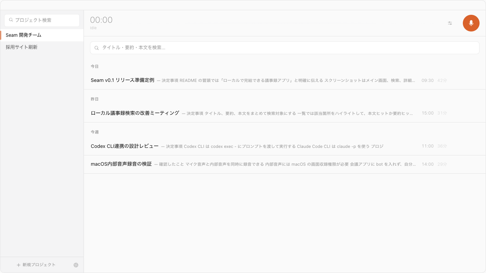

<p align="center">
  
</p>

# Seam - Local-First Minutes

Seam は、**会議の録音・文字起こし・要約をローカル環境中心で完結**させる macOS 向けアプリです。  
デスクトップUI（Tauri + React）とバックエンドAPI（FastAPI）を分離し、実運用しやすい構成で実装しています。

<p align="center">
  
</p>

## ダウンロード

最新版の DMG は [Releases ページ](https://github.com/Tocchizawa/Seam-LocalFirstMinutes/releases) からダウンロードできます。
DMG を開いて `Seam.app` を `Applications` にドラッグするだけでインストール完了です（Apple Developer ID 署名 + 公証済み）。
インストール後は設定画面から更新確認できます。起動時自動アップデートを有効にすると、次回起動時に更新を見つけた場合だけ自動で適用します。

ビルドはご自身でも可能です。手順は [ローカル実行（開発）](#ローカル実行開発) と [ビルド](#ビルド) を参照してください。

## プロジェクトの狙い

- ローカルで高速に議事録を作れること
- 会議データの取り扱いをシンプルにできること
- 1人開発でも保守しやすい構成にすること

## 主な機能

### 1. 録音・リアルタイム文字起こし

- マイク録音 + システム音声録音（任意）を同時に実行
- 録音中にリアルタイムで文字起こしを表示
- VAD（`silero` / `energy`）で発話区間を分割して安定処理
- 録音中のマイクソフトミュート切り替え
- 録音停止忘れ通知（無音が続いた場合）

### 2. 議事録管理

- 録音停止後に議事録を自動保存（SQLite）
- 要約と全文書き起こしを同じ議事録で管理
- タイトル編集・要約編集・削除・プロジェクト再割り当て
- 議事録を Markdown でエクスポート（要約 + 全文）
- 保存済み音声から文字起こしを再実行
- 全文検索（SQLite FTS5 trigram）

### 3. 話者管理

- 話者分離方式の切り替え（`legacy` / `pyannote`）
- 話者プロファイルの一覧・リネーム・統合・削除
- 話者サンプル音声の再生
- `pyannote` 用の HuggingFace トークン保存 / テスト

### 4. 要約（複数プロバイダ）

- Ollama（ローカル）
- Claude API
- OpenAI API
- Claude Code CLI
- Codex CLI
- 録音停止時の自動要約、または議事録ごとの手動再要約
- 要約後の辞書更新（用語集 / 誤転写補正）を自動化

### 5. プロジェクト運用

- プロジェクトの作成・更新・削除
- プロジェクトごとの出力先ディレクトリ管理
- コンテキスト参照用の `repo_path` / `doc_dirs` 設定
- 用語集と誤転写補正ルール（`wrong` → `correct`）の管理
- ドキュメント群からの用語集候補の自動抽出

### 6. リアルタイム議論ノート（任意）

- 録音中の確定発話をテーマ別に蓄積し、以前の話題に戻った場合は元の見出しへ追記
- 提案・決定・懸念・未解決事項・アクションを区別し、発話の根拠を保持
- 見出しとMarkdownブロックを直接編集。手動変更はAIから保護し、競合案は保留
- 録音停止後も同じノートを閲覧・編集・検索・Markdown出力
- Codex CLI / Claude Code CLI の既存ログインとモデル設定を使用（追加APIキー不要）

初期状態は **OFF** です。設定の「リアルタイム議論ノート」で「次の録音でライブノートを使用」をONにし、
CodexまたはClaude Codeを選択し、送信内容の説明に同意して保存してください。
「ライブノートのモデル」で録音後要約とは別のモデルを選べます。Codexでは頻繁な更新向けに
GPT-6 Luna（`gpt-6-luna`）を推奨候補として表示します。未指定なら要約設定を継承します。
候補がない場合はモデルIDを直接入力できます。利用可否はCLI・アカウントによって異なります。
「CLIの利用可否を確認（推論なし）」で必要なCLI機能を確認できます。既存の要約AIがCLIなら設定を引き継げます。
方式・provider・modelは録音開始時に固定され、設定変更は次回の会議から適用します。

Whisperの音声認識はローカルですが、**発話テキスト・ノート文脈は選択したLLM提供元へ送信されます**。
音声そのものは送信せず、音声と文字起こしはこの端末の保存領域に残ります。Codex/Claude CLIを選ぶ場合は、推論対象となる発話テキストとノート文脈がその提供元へ渡るため、送信内容を確認してから有効化してください。
会議参加者への録音通知・同意と、CLIの契約・利用枠を確認してください。
必要なCLI制限に対応しない版、認証切れ、利用制限ではAI整理を停止し、録音・文字起こし・手動編集を続けます。

AI整理は通常20〜60秒程度の発話をまとめ、CLI応答後に反映します。consolidation間隔と最低batch数は設定可能です。秒単位の更新は保証しません。
「AI一時停止」中も発話は保存されます。停止後に整理が残る場合は、保存済み議事録から再試行できます。
ライブノートを使う会議では、従来の録音後全文要約による上書きを行いません。
OFFの場合は従来の録音後要約を利用します。

## 実装状況メモ

ライブノートv3はschema v3の意味操作で、項目の状態、質問の会話上の回答と外部資料による検証、話題・項目間の関係を別々に保持します。質問が会話で回答されても外部検証済みにはなりません。手動で編集した内容は保護され、削除・却下した内容の再生成を抑えます。v1/v2の保存済み操作とSQLiteデータは加算migrationで読み込みます。実装契約と既存評価範囲は [v2評価レポート](./docs/live-notes-v2-report.md) を参照してください。[v3評価手順と結果](./docs/live-notes-v3-evaluation.md) に記す通り、合成データの構造試験は通過していますが、実会議でのモデル品質はCLIローカル実行エラーにより未判定です。

- `Gemini` は設定UI/APIの枠はありますが、要約本体は未対応です
- システム音声録音は macOS のシステム音声取得権限が必要です
- ローカル完結運用が基本ですが、Claude/OpenAI などクラウド要約も選択可能です

## 技術スタック

- Desktop: Tauri + React + TypeScript
- Backend: FastAPI (Python)
- AI/ML: mlx-whisper / Silero VAD / pyannote / Ollama / 外部LLM
- Storage: SQLite + YAML + Keyring
- Build: pnpm / uv / Rust toolchain

詳細は [docs/tech-stack.md](./docs/tech-stack.md) を参照してください。

## ローカル実行（開発）

前提:

- macOS
- Python 3.11+
- Node.js 20+
- `pnpm` 9+
- Rust (stable)
- `uv`
- `ffmpeg`

```bash
uv sync
pnpm -C gui install
pnpm dev
```

`pnpm dev` で Tauri 開発モードが起動し、バックエンドはアプリ側から起動します。

## ビルド

```bash
pnpm build
```

生成物:

- `gui/src-tauri/target/release/bundle/macos/Seam.app`
- `gui/src-tauri/target/release/bundle/dmg/Seam_<version>_aarch64.dmg`

Apple Developer IDの設定がないローカルビルドはアドホック署名で、公証された公開配布物にはなりません。

## セキュリティ / プライバシー方針（要点）

- バックエンドは `127.0.0.1` バインドが既定
- `/api/*` はローカル接続のみ許可（必要時のみ設定で緩和）
- 更新系APIは Origin も検証
- APIキーは macOS Keyring に保存

詳細は [SECURITY.md](./SECURITY.md) を参照してください。

## 設定の優先順（UIと環境変数）

1. 設定画面で保存した値
2. Keyring に保存したトークン
3. 環境変数

保存先:

- 一般設定: `~/.seam/config.yaml`
- APIキー / HFトークン: macOS Keyring（`seam-app`）

参照する主な環境変数:

- `OPENAI_API_KEY`
- `ANTHROPIC_API_KEY`
- `HF_TOKEN`
- `HUGGING_FACE_HUB_TOKEN`
- `OLLAMA_HOST`

`.env` は自動読込しません。必要時に `export` して使います。  
ひな型: [`.env.example`](./.env.example)

## ディレクトリ構成

```text
.
├── docs/
├── gui/
├── scripts/
├── src/
├── tests/
└── sidecar/
```

## 最低限の検証

```bash
uv run python -m pytest tests/ -q
uv run python scripts/run_tests.py --scripts
uv run python scripts/run_tests.py --api
pnpm -C gui build
./scripts/oss_preflight.sh
```

Python試験は一時HOMEで実行し、既存の直接実行型チェックも別プロセスで集計します。
実音声・実サービス依存試験の前提条件と、ライブノートの手動確認手順は
[docs/live-notes-testing.md](./docs/live-notes-testing.md) を参照してください。

高速チェック（GUI build 省略）:

```bash
SKIP_GUI_BUILD=1 ./scripts/oss_preflight.sh
```

## ドキュメント

- 要件: [docs/requirements.md](./docs/requirements.md)
- 設計: [docs/architecture.md](./docs/architecture.md)
- データモデル: [docs/data-model.md](./docs/data-model.md)
- 要約設計: [docs/summarize-design.md](./docs/summarize-design.md)
- ライブノート仕様・受け入れ条件: [docs/SEAM_REALTIME_AGENTIC_NOTES_DESIGN.md](./docs/SEAM_REALTIME_AGENTIC_NOTES_DESIGN.md)
- ライブノートv2目標設計: [docs/SEAM_LIVE_NOTES_V2_DESIGN.md](./docs/SEAM_LIVE_NOTES_V2_DESIGN.md)
- ライブノートv2品質サンプル: [docs/SEAM_LIVE_NOTES_V2_GOLDEN_SAMPLE.md](./docs/SEAM_LIVE_NOTES_V2_GOLDEN_SAMPLE.md)
- ライブノートv2評価レポート: [docs/live-notes-v2-report.md](./docs/live-notes-v2-report.md)
- ライブノートv2実装契約・評価手順: [implementation-notes-v2-docs.md](./implementation-notes-v2-docs.md) / [tests/fixtures/live_notes_v2_scenario.json](./tests/fixtures/live_notes_v2_scenario.json)
- ライブノートv2 UI参考モック: [reference/SEAM_LIVE_NOTES_V2_UI_MOCK.html](./reference/SEAM_LIVE_NOTES_V2_UI_MOCK.html)
- ライブノートの検証・復旧手順: [docs/live-notes-testing.md](./docs/live-notes-testing.md)
- 実装判断・DoDとの対応・検証範囲: [docs/live-notes-implementation.md](./docs/live-notes-implementation.md)

## 開発・運用

- コントリビュート: [CONTRIBUTING.md](./CONTRIBUTING.md)
- セキュリティ: [SECURITY.md](./SECURITY.md)
- ライセンス: [Apache 2.0](./LICENSE)
