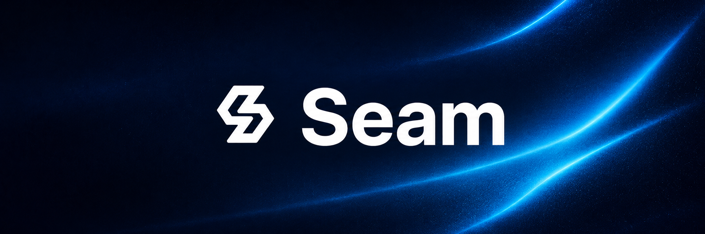

<p align="center">
  
</p>

# Seam - Local-First Minutes

Seam は、会議の録音、文字起こし、要約をローカル環境中心で扱う macOS アプリである。デスクトップ UI は SwiftUI、ローカル API と議事録処理は FastAPI、録音中の文字起こしは macOS の Apple Speech を使う。

## ダウンロード

最新版の DMG は [GitHub Releases](https://github.com/Tocchizawa/Seam-LocalFirstMinutes/releases) から取得できる。DMG を開いて `Seam.app` を Applications フォルダへ移す。

アプリの実行には Apple Silicon と macOS 26 以降が必要である。Apple Speech の言語リソースが未取得の場合、最初の文字起こし時に macOS が準備する。

## 主な機能

- マイクとシステム音声の録音
- 録音中に進む Apple Speech の文字起こしと一時プレビュー
- 録音、文字起こし、要約をまとめた議事録管理
- 保存済み音声からの再文字起こし
- SQLite 全文検索、Markdown エクスポート、プロジェクト管理
- Ollama、Claude API、OpenAI API、Claude Code、Codex による要約
- 用語集と誤転写補正ルールの管理

文字起こしは話者を割り当てず、発話時刻と本文を保存する。従来版の議事録、音声、設定フォルダ `~/.seam` は引き続き利用する。以前の議事録に含まれる話者情報は保存データ内に残るが、現行 UI では利用しない。

## 開発環境

必要なもの:

- Apple Silicon Mac、macOS 26 以降
- Xcode Command Line Tools
- Python 3.11 以降、`uv`
- Swift 6.2 以降

バックエンドを開発実行する:

```bash
uv sync
uv run python -m src.main
```

SwiftUI アプリと Apple Speech ヘルパーをビルドする:

```bash
swift build --package-path macos --product SeamApp
swift build --package-path macos --product AppleSpeechTranscriber
```

配布用アプリと DMG を作成する:

```bash
bash scripts/build-native.sh
```

生成物は `macos/.build/distribution/` に置かれる。同梱バックエンドの作成には `uv` と Xcode Command Line Tools が必要である。配布署名を行う場合は `APPLE_SIGNING_IDENTITY` を指定する。

## 設定とデータ

- 設定と議事録データ: `~/.seam/`
- OpenAI / Anthropic API キー: macOS Keychain または環境変数
- `.env` は自動読込しない。必要な環境変数は起動前に `export` する。
- 文字起こし言語はアプリの設定から指定する。

環境変数のひな型は [`.env.example`](./.env.example) を参照。

## ディレクトリ

```text
.
├── macos/       # SwiftUI アプリ、共通 Swift コード、Apple Speech ヘルパー
├── sidecar/     # macOS 音声キャプチャ用バイナリのソース
├── src/         # FastAPI バックエンド
├── scripts/     # 開発・配布スクリプト
├── tests/       # 既存機能の確認用コード
└── docs/        # 設計・要件資料
```

詳細は [アーキテクチャ](./docs/architecture.md)、[データモデル](./docs/data-model.md)、[技術スタック](./docs/tech-stack.md) を参照。
