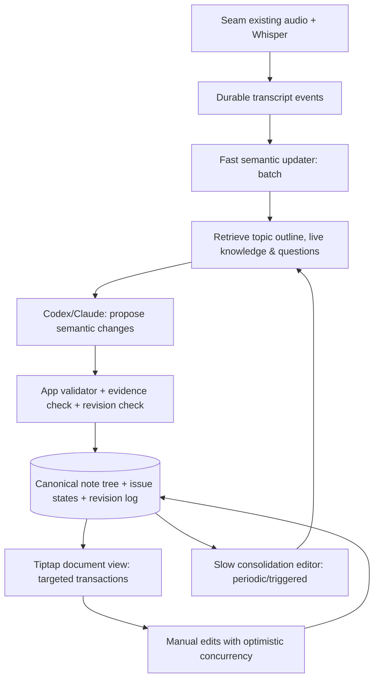

# Seam Live Notes v2 — 意味で整理され続ける会議ノート

> ステータス: 設計確定案 / AI一括改修用
> 作成: 2026-10-18
> 対象基盤: [Tocchizawa/Seam-LocalFirstMinutes](https://github.com/Tocchizawa/Seam-LocalFirstMinutes) v0.2.3 / 調査時HEAD `418941d0c755fb4f074ca7d006120274e6f6e5d6`
> 入力: ユーザー提示の23分間の文字起こしと、現状生成されたリアルタイムノート、および従来の `SEAM_REALTIME_AGENTIC_NOTES_DESIGN.md` v1
> 注: 実装済みのユーザーの作業ブランチは未取得。**本書は既存GitHub基盤と提示出力から導いた改修仕様であり、現行の改修コードの動作保証ではない。** 作業時に実コードを再調査して差分を特定すること。

## 0. 最重要な設計判断

**ノートを「発言の箇条書き集合」から「議論により徐々に完成する知識文書」に変える。**

- 入力は時系列の発言だが、出力は**意味別に構成されたノート**。発言順をMarkdown本文の構造と一致させない。
- 一つのテーマの質問→検証→回答→結論は、**同じセクションを進化**させる。質問・回答・確認を別々の箇条書きにしない。
- 新しいテーマなら新しい見出しを追加、既存テーマなら既存箇所を更新する。**過去の話題を保持**し、戻ったら再更新する。
- **統合、解決、訂正、構造化、移動、撤回**が必須。v1の`create_topic/add_block/update_block/rename_topic/set_active_topic`中心の仕様を置換する。
- ノートはユーザーも直接編集。AIは編集した場所を侵さず、競合は差分提案する。
- **表示を静かに**する。画面を飛ばさず、読み書き中は安定。AI進捗は低優先度。
- 一律テンプレートを強制しない。技術解説・仕様決定・比較検討・課題解決・ブレインストーミングで**見出しの意味構造を変える**。
- AIは**変更案のみ**を返し、アプリ側が検証・保存・適用する。Codex/Claude CLIのファイル書込やコマンド実行を使ってノートを更新させない。
- 旧v1設計の録音・文字起こし・プロバイダ設定・安全性・永続化の要件は継承。ただし**AI操作モデル、UI、品質評価、エディタ方針は本v2を優先**。

## 1. 現状の分析と根本原因

### 1.1 提示例から確実に観察できたこと

対象: `20261018_123817-notes (1).md` と対応する発話テキスト、23分の「NRI共通部品とgRPC受付部品のつながり」に関する会話。

- 出力はほぼ単一見出しの下に「論点」「未解決」「アクション」の多量の項目が並ぶ。
- 同じことを言い換えた内容が複数の別項目となる。例: `NriDeps` が `NewNriPoint` に渡されていない、という結論が複数回記録される。
- 初期の「未解決」が、後半で回答されたあとにも残る。解決済みの問いが未解決に見える。
- 質問から回答に至る学習・調査の流れをまとめず、個々の確認発言を独立した意味単位として扱う。
- ASRの揺れ（nri lips, nri dips, new grip server 等）を概念単位で十分に正規化できていない。
- 最も重要な結論と処理フローが文章の後半に埋もれ、**読んですぐ要点を掴めない**。

会話の内容に照らすと、出力文書の妥当な骨格は、例えば次のようになる。

1. 「結論：NRI共通部品は生成されているがNRIハンドラーにまだ接続されていない」
2. 「現状の処理フロー：生成→NewGRPCServerへ受け渡し→引数未使用→NewNriPoint引数なし→gRPCへの登録」
3. 「各部品の役割」
4. 「接続する場合の変更方針」
5. 「実コードでの確認事項」

これは**会話を時系列で圧縮した議事録ではなく、会話で分かったことを整理した理解ノート**である。

### 1.2 旧v1設計そのものの制約

旧v1の操作定義には`create_topic`, `add_block`, `update_block`, `rename_topic`, `set_active_topic`, `no_op`しかない。**複数項目の統合、古い未解決の解消、表現の置換、構造再設計**に対応する操作がない。旧プロンプトも「新しい発言をトピックへ分類して追加」が中心。そのため、良質なモデルでも操作の制約によって追記型に偏る。

**旧仕様を守って実装が正しく動いたとしても、望む品質になるとは限らない。** UIだけ変えても解決しない。

### 1.3 残る未検証点

実際にユーザーが改修した最新コードはこの会話に添付されていないため、現在のハーネスがどの操作を実装済みか、設定やプロンプトが旧案と同じかは確定できない。実装エージェントは `src/live_notes` などの現行実体を必ず調べ、責務・操作契約・適用箇所を照合すること。

## 2. 競合/技術調査から採用する考え方

| 出典 | 確認できた性質 | Seam v2へ取り入れる点 |
|---|---|---|
| [Microsoft Teams Facilitator](https://support.microsoft.com/ja-jp/teams/copilot/facilitator-in-microsoft-teams) | 会議中にAI生成ノートと共同編集、決定/未解決の要約。トピック・時間の可視化 | 会議中の読みやすいノート、目次＋控えめな現在位置、手動編集 |
| [Granola AI-enhanced notes](https://help.granola.ai/article/ai-enhanced-notes) | 文字起こしとユーザーの生メモを使い、会議終了後にノートを強化。根拠位置を参照可能 | 手動メモはノイズではなく文脈。文書を「理解できる完成形」へ編集、根拠へ戻れる |
| [Notion AI Meeting Notes](https://www.notion.com/help/ai-meeting-notes) | 会議種別に応じた要約指示、リアルタイムメモとの組み合わせ | 表現・セクションを会話内容で選ぶ、事前テンプレート固定を避ける |
| [Tiptap UniqueID](https://tiptap.dev/docs/editor/extensions/functionality/uniqueid) | ノードに安定IDを付与、分割・統合・Undo/Redo対応 | 意味単位の識別と更新対象の特定 |
| [Tiptap TableOfContents](https://tiptap.dev/docs/editor/extensions/functionality/table-of-contents) | 見出しに基づく目次情報と現在位置を提供 | 見出しから動的な目次を構築する |
| [Tiptap Content Commands](https://tiptap.dev/docs/editor/api/commands/content) | `setContent`は全文置換、`insertContentAt`は範囲限定 | 全文再設定を使わない局所的なProseMirror transaction |
| [Tiptap AI Toolkit](https://tiptap.dev/docs/ai/ai-toolkit/client/workflows/tiptap-edit) | 範囲・ノード単位のAI編集、レビュー等の実装例。AI Toolkitは有料系パッケージ | 設計の参考。**導入必須とせず、OSS Tiptap上に自前実装** |

**機能の公開説明に基づく比較であり、競合サービスのノート品質や内部アルゴリズムの優劣を実地検証したものではない。**

## 3. プロダクトの達成基準

会議途中の利用者が、ノートを数秒眺めて次を理解できること:

1. いま何を理解・決定・検証しているのか。
2. これまでの議論で**何が分かったのか**。
3. 結論に至った理由・前提・反対案は何か。
4. まだ分からないことは何か（**既に解決された問いを含めない**）。
5. 以前の話題にどう戻ればよいか。

### 禁止パターン

- 発言を1つずつ「論点:」「未解決:」「アクション:」で追加し続ける。
- いつまでも「未解決」が残り、後から得られた回答が別の行に増える。
- メモを上から順番に何度も読み返さないと結論が分からない。
- 内容に関係なく毎回固定の「結論/課題/アクション」テンプレートを無理に埋める。
- 読んでいる位置をAIの都合でスクロールする。
- 編集中に全文リセットする。
- LLMがノート全体の一括再生成を実行し、ユーザーの文面を消す。

## 4. 情報構造: 発言ではなく「テーマと知見」

### 4.1 3階層

1. **Meeting**: 会議全体。
2. **Topic / Section**: 意味で分類した大きなテーマと、その下位セクション。発話順とは無関係に安定したID。
3. **Knowledge unit (Block)**: 会話から得た、再利用価値のある結論・根拠・懸念・論点・保留事項・手順・比較項目等。

すべてのBlockは生の発言とは別のもの。1つのBlockに複数の発言を統合でき、後続で**同じBlockを進化**させる。

### 4.2 意味論を明示

Knowledge unitの属性例:

- `semantic_role`: `explanation / fact / conclusion / decision / option / reason / risk / open_question / action / code_path / comparison / note`（表示ラベルの強制ではない）
- `epistemic_state`: `tentative / supported / confirmed / disputed / superseded / unknown`
- `resolution_state`（質問等のみ）: `open / answered / deferred / not_applicable`
- `source_segments`: 発言ID・時間範囲。発言をそのままノートに表示せず、クリックして根拠として確認する。
- `user_touched`, `protected`, `revision`。
- `aliases`/`canonical_terms`: 「nri lips」「nri dips」のような文字起こし表記と、根拠付き正規表現 `NriDeps` の対応。

**注意**: `confirmed`は「会議中にそう説明/合意された」という強さ。コードが正しいことの検証とは別に`verified_against_source`属性を持つ。コード未確認の仕様を確定的な実装事実と書かない。

### 4.3 見出し/レイアウトは内容に合わせる

| 会話の性質 | 適切なノート構造例 |
|---|---|
| 実装の理解・技術解説 | 要点 → 処理の流れ → 役割 → 理由 → 変更/確認事項 |
| 選択肢の比較 | 前提 → 選択肢 → 比較軸 → トレードオフ → 暫定/最終判断 |
| 障害調査 | 症状 → 再現/影響 → 原因候補 → 調査結果 → 対処 → 未検証点 |
| 仕様決定 | 背景 → 要件 → 論点 → 判断/根拠 → 保留 → アクション |
| アイデア会議 | 課題 → アイデア群 → 方向性 → 採用/保留 → 次の実験 |

同一会議でもテーマAは技術解説、テーマBは比較検討、と分けて良い。テンプレートは**編集上の文書計画**であり、一定のラベル群を毎回作る義務ではない。

### 4.4 「未解決」の扱いを全面変更

- 単発の疑問はまず**内部のpending question**として保持。表示する価値が高い場合だけノートに出す。
- その場で回答された問いは、質問行を永遠に残さず**回答を「理解したこと」「原因」へ統合**する。
- 議論として明示的に持ち越されたもの、またはまだ説明がない主要論点は「確認事項」に表示。
- 発話が一時的に途切れただけで未解決と断定しない。
- 質問の解決は操作履歴に残す。公開ノート本文は常に現在の整理済み状態を示す。
- 引き続き重要な「未決定の仕様」は保持。単に整理途中だからと消してはいけない。

### 4.5 情報保持の基本ルール

- **残す**: 結論、意思決定、背景、反対意見（判断に重要なもの）、前提、制約、影響、確認事項、担当と期限。
- **集約する**: 言い換え、同じ質問の再発、質問と回答、正解に至る確認の反復。
- **本文に残さず証跡化**: 相づち、繰り返し、途中の聞き間違い、無関係な脱線、操作指示、話者を誘導する発言。
- **絶対に捏造しない**: 根拠のない関数名・ファイル名・結論、未確定の意思決定。
- 元の発言は耐久保存し、本文から除外したからといって消さない。

## 5. UI/UX 設計

### 5.1 コンセプト: Quiet Living Document

**「AIが走り回るダッシュボード」ではなく、「自分の代わりに静かに整っていく文書」**。主役はMarkdownノート。

#### Desktop（横幅1300px程度）

```text
┌──────────────────────────────────────────────────────────────────────────────┐
│ Seam  /  NRI連携の理解                     ●録音 18:25  AI: Claude [停止]   │
├──────────────────┬────────────────────────────────────────┬──────────────────┤
│ 目次              │ NRI共通部品とgRPCハンドラーのつながり       │ 最近の更新/出典     │
│                  │                                        │                  │
│ 全体の要点         │ まず押さえること                           │ 18:23            │
│ 1. 現在の処理フロー │ 共通部品は作られているがNRI側に未接続。     │ 「未解決」を解消     │
│ 2. 部品の役割       │                                        │ 12分時点の発言      │
│ 3. 接続方針   ◉    │ 1. 現在の処理フロー                     │ [根拠を表示]       │
│ 4. 要確認点        │   main → NewGRPCServer → ...            │                  │
│                  │                                        │ 18:08            │
│                  │ 2. 部品の役割                          │ 接続方針を更新     │
│                  │   NriDeps: ...                         │                  │
│                  │                                        │                  │
│ [現在へ追従]       │ 3. 接続方針               [最近更新]      │ [変更履歴]         │
├──────────────────┴────────────────────────────────────────┴──────────────────┤
│  AI整理完了 18:23  ・ 文字起こしは継続       [議論ノート] [文字起こし]        │
└──────────────────────────────────────────────────────────────────────────────┘
```

- 3ペインの**右ペインは常時必須ではない**。初期表示は折り畳み、ユーザーが「変更/出典」を開くと表示。
- 左目次は見出しの階層を示し、クリックで移動。単純な自動連番ではなく**意味ある見出し名**を表示。
- 中央は一つながりの文書で直接編集可能。行や段落をマイクロカードとして大量に並べない。
- トップに「まず押さえること」数行の**軽い要点セクション**を置いてもよい。ただし会話が浅い時点では空でも構わない。不要なKPIカードは作らない。
- ユーザーが過去を読んでいるときはスクロール固定。現在の話題の位置は目次の小さな印で示す。
- 文字起こしはサブタブ/サイドパネルで確認できるが、メインにはしない。

### 5.2 フォロー状態を明確に分ける

- **閲覧モード（デフォルト）**: AI更新でスクロールしない。ユーザーが読みたい場所に留まる。
- **会話に追従**: 目次で現在議論中のテーマを追う（本文を無理にスクロールさせず、「この話題へ移動」を提示）。ユーザーが操作したら追従を一時解除。
- **編集中**: 同一ノードへのAI更新を保留。別ノードは静かに更新。入力と選択を保存。
- **更新を確認**: 「3つの説明を1つに統合」「疑問を解決に更新」のような**意味ベースの変更説明**を表示。変更前後の比較とUndo。

### 5.3 画面上の更新アニメーション

- 新規見出し: フェード(150～250ms)、目次に控えめな小ドット。
- 既存内容の修正: 変化した行だけ淡いアクセント背景(最大2秒)。全文点滅禁止。
- 統合/構造移動: 現在読んでいる・編集しているセクションならUIへの反映を保留し、案内を出す。
- 他セクションの更新: 閲覧中のスクロール位置を維持。アニメーションで位置を揺らさない。
- トーストを毎回出さない。新しいAIノート更新は基本サイレント。
- AIが作業中でも内容が未完成なら上書きしない。**部分JSONのストリーミングをそのまま文書として露出しない**。

### 5.4 本文タイポグラフィと視覚設計

- Seamの既存テーマを継承し、白〜中立グレー主体、アクセントは1色のみ。
- 本文幅 700〜800px、文字14〜15px、行間1.65〜1.8、段落間10〜16px。
- H1はページタイトルに1個、主要なテーマをH2、補足の概念をH3。H4乱用禁止。
- 箇条書きは独立した並列の事実のみに使用。因果関係や理解の核心は短い段落にする。
- コード記号・関数名はmonospace。呼び出しの流れは番号付き手順またはコードブロック。
- 「未解決」「要確認」「決定」などのラベルは**本当にその状態があるときだけ**使用。全行に接頭辞を付けない。
- 左目次幅 220〜260px、右補助パネル 260〜320px、モバイル相当の狭いウィンドウでは片側を閉じる。
- 読み上げ/キーボード操作にも対応。位置表示は色だけに頼らない。

### 5.5 UIの状態遷移

| 状態 | メインUI | AIの振る舞い |
|---|---|---|
| 開始直後 | 「音声を聞き取り中」。空テンプレを大量生成しない | 関連テーマの初期形成を待つ |
| 論点が成立 | 初めて意味ある見出しと数行が出る | 現テーマのメモを作る |
| 質問の調査中 | 短い「確認中」の問いと仮説明 | 問いのIDを保持 |
| 回答が出る | その項目を結論/原因へ書き換え | 解決イベントを記録 |
| 新しい話題 | 既存ノートを残して新見出しを作成 | 類似テーマ検索後に新規作成 |
| 話題が戻る | 旧見出し内を更新 | 同じtopic_idへ反映 |
| 人が編集 | そのまま自由に入力 | 保護範囲へ直接上書きしない |
| 会議終了 | 整理済みノート、必要な未決事項と履歴 | 最終整合パス（ただし人間の修正は維持） |

## 6. 新しい Agentic Harness — 2つの時間スケール

### 6.1 データフロー



### 6.2 Fast semantic updater（意味の増分反映）

目的: 会話についていくこと。仮の理解を安定的に更新する。

- 数字は初期チューニング値。`min_interval=18s`, `target_interval=35s`, `max_wait=75s` から検証。
- コールごとに全発言を渡さず、未処理発言＋現在目次＋関係のあるセクション＋open questionsを渡す。
- 1セッション1in-flight。実行が遅い場合は発言を捨てずキューを結合する。
- 1バッチ1回のLLMを基本とし、invalid JSON等の場合のみ限定リトライ。
- LLMは**内容の追記より先に、既存問題の更新・解消・統合**の可能性を判定する。
- 安全な`NO_CHANGE`は正常。あいづちや言い直しでノートが肥大化しない。

### 6.3 Slow consolidation editor（編集者としての再整理）

目的: 追記による乱れや、後から見える意味関係を整える。

- **時間トリガー**: 3〜5分ごと、または同一topicに多数の更新が溜まったとき／解決イベントがあったとき。
- **範囲**: 変更のあったtopic/近縁topicだけ。会議全体を書き直さない。
- **仕事**: 重複項目の統合、説明順序の整理、未解決の更新、見出しの改善、短い要点への昇格、階層変更。
- 対象topicのAI所有要素のみ自動適用。人が編集した要素を含む大幅な再構成は**差分提案**。
- 明確な意味保存・根拠保持が検証できなければ自動統合しない。
- fast updaterと同じLLM実行キューで直列処理し、録音・Whisperを妨げない。混雑時はslow passをスキップ/延期。
- LLM実行上限・1セッション内の頻度制限・ユーザーによる一時停止を設ける。

### 6.4 エージェントの内部状態

`session_goal`, `topic_index`, `topic_aliases`, `pending_questions`, `resolved_questions`, `recent_conclusions`, `last_confirmed_claims`, `manual_protected_ranges`, `processed_segment_cursor`, `revision`, `pending_suggestions`。

- **ノート本文だけ**から内部状態を復元しない。必ずSQLiteに独立保存。
- `topic_index` はタイトル/要点/代表用語/関連ID/会話時間のインデックス。判断材料であって本文ではない。
- `pending_questions` の状態変化を追い、「既存問いの解決」を第一級の操作として扱う。
- 表記補正: 用語集・同一会議での明確な言い直しなど根拠がある場合だけ正規化し、根拠不明なら不確実フラグを残す。

### 6.5 1バッチの決定手順

1. 発言取り込み、タイムスタンプとsegment ID保存。
2. ノイズ・重複・ASR異常の候補判定（生ログは変更しない）。
3. 内容から扱っているtopic候補／既存question候補を検索。
4. 既存概念の状態変化か、新概念か、単なる言い換えかを判定。
5. LLMに`SemanticEditPlan`を依頼。
6. スキーマ/ID/発言根拠/決定の言い過ぎ/版数/編集保護/意味保存を検証。
7. 安全な局所編集はトランザクション適用。衝突は提案化。
8. topic digest とQuestion state、revision ledgerを更新。
9. WebSocketに**確定済み編集だけ**通知。
10. 遅延/再試行があれば可視化。録音は継続。

## 7. 編集操作の契約（v1から置換）

### 7.1 必須操作

| action | 説明 | 自動適用範囲 |
|---|---|---|
| `CREATE_TOPIC` | 新たな意味テーマを作成 | 類似topicを探索してから |
| `UPSERT_KNOWLEDGE` | 新知見追加／既存知見の内容更新 | AI所有blockか新規block |
| `RESOLVE_QUESTION` | 未解決の問いを回答済みにし、答えを本文の適切な場所へ反映 | question ID・明確な発言根拠必須 |
| `REVISE_CLAIM` | 仮説→確認済み、説明の訂正、限定条件の追加 | AI所有かつ意味根拠あり |
| `MERGE_BLOCKS` | 同義・補完関係の複数blockを一つに統合 | **AI所有だけ**、出典の和を保存 |
| `MOVE_BLOCK` | 内容を意味的に適切な見出しの下へ移す | 読書位置を変えない時。人間のノードは提案のみ |
| `RESTRUCTURE_TOPIC` | 見出し/小見出し構成を改善、複数topicを統合または分割 | 小規模かつAI所有範囲だけ自動、それ以外は提案 |
| `UPDATE_TAKEAWAY` | 「まず押さえること」を更新 | 根拠と本文に一致する短文のみ |
| `SUGGEST_EDIT` | 人の編集箇所への変更案を保持 | 自動上書き禁止 |
| `NO_CHANGE` | 有意な情報がない | 正常動作 |

`MERGE_BLOCKS` や `RESTRUCTURE_TOPIC` の**安全な操作は自動で使えること**。これが追記型から脱却する鍵。ただしUndoと版管理は必須。

### 7.2 Structured Outputの例（論理スキーマ）

```json
{
  "schema_version": 2,
  "batch_id": "sessionA:77-93",
  "base_revision": 41,
  "reason": "以前の未解決を、今回の回答で解消できる",
  "operations": [
    {
      "op_id": "sessionA:77-93:1",
      "type": "RESOLVE_QUESTION",
      "question_id": "q:nri-deps-wiring",
      "target_topic_id": "t:nri-wiring",
      "resolution_md": "共通部品はNewGRPCServerまで渡されるが、引数として使用されず、NewNriPointにも渡されていない。",
      "source_segments": [83, 84, 90, 92],
      "expected_revision": 6
    },
    {
      "op_id": "sessionA:77-93:2",
      "type": "MERGE_BLOCKS",
      "source_block_ids": ["b:old-question", "b:repeated-question"],
      "target_block_id": "b:wiring-explanation",
      "merged_md": "NRI共通部品がNRIハンドラーに渡されていない理由は、NewGRPCServerで未使用のまま保持されず、NewNriPointを引数なしで生成しているため。",
      "source_segments": [19, 27, 83, 84],
      "expected_revisions": {"b:old-question": 2, "b:repeated-question": 3, "b:wiring-explanation": 4}
    }
  ]
}
```

**注意:** 例の `segment` 番号とIDは模式値。実装では既存SQLiteのIDから生成する。JSON Schemaは各操作の判別UnionをPydanticで定義し、複雑すぎる場合は型共通＋`payload`を二段検証。`reason`はユーザーに必要な短い変更要約であり内部推論の全文ではない。

### 7.3 厳密な適用規則

- **意味保存**: `MERGE_BLOCKS` は元block群の検証可能な事実・例外・条件・未決点を落としていないかチェックする。厳密な意味判定を機械だけで証明できないため、重要な決定・反対意見を含む場合は提案に回す。
- **証跡保存**: `source_segments` は元の出典の集合を必ず継承。統合されたblockは旧ID→新IDのエイリアスを持つ。
- **削除は論理的**: AI編集時にold blockは`superseded_by`、`archived_at`として残す。ユーザーからUndo可能。
- **未解決を解消**: `RESOLVE_QUESTION` は本文の「未解決」表示を終了し、現在の本文に回答を配置。元の質問はイベントログから確認可能。
- **根拠と状態**: 提案を決定事項へ格上げするには明示合意など強い根拠が必要。
- **人間保護**: `user_touched`, `locked`, active editing node はAIが変更不可。必要なら`SUGGEST_EDIT`。
- **トピック重複防止**: 同じIDの再利用禁止、類義語/参照先統合後もanchor別名解決を維持。
- **同期**: 失敗した一部operationでバッチ全体を二重実行しない。op_id単位で冪等処理。

## 8. データモデルと移行

現行作業ブランチにv1のDBテーブルがある可能性を考慮し、**破壊的な再作成は禁止**。既存 `live_note_topics`, `live_note_blocks` 等があればスキーマmigration/adapterを作る。

最低限必要な論理エンティティ:

1. `live_sessions`: `session_id PK`, `minutes_id nullable`, `revision`, `state`, `processed_seq`, `provider`, `last_quality_pass_at`。
2. `live_transcript_segments`: `session_id`, `seq`, `start_ms`, `end_ms`, `raw_text`, `normalized_text nullable`, `speaker_label nullable`, `status`。複合UK・再送冪等。
3. `live_topics`: `topic_id PK`, `session_id`, `parent_topic_id nullable`, `title`, `digest`, `aliases_json`, `sort_key`, `active`, `revision`, `user_touched`, `archived_at`。
4. `live_note_nodes`: `node_id PK`, `session_id`, `topic_id`, `parent_node_id`, `node_type`, `semantic_role`, `content_md`, `sort_key`, `revision`, `owner`, `user_touched`, `locked`, `superseded_by`, `archived_at`。
5. `live_questions`: `question_id PK`, `session_id`, `topic_id`, `text`, `state`, `answer_node_id nullable`, `resolution_evidence_json`, `revision`, `created_seq`, `resolved_seq`。
6. `live_node_evidence`: `node_id`, `segment_seq`, `span_start_ms`, `span_end_ms`, `support_type`。引用/根拠検索。
7. `live_change_log`: `change_id PK`, `session_id`, `origin ai|human`, `batch_id`, `op_id UNIQUE`, `before_json`, `after_json`, `reason`, `revision`, `created_at`。
8. `live_agent_jobs`: `job_id PK`, `session_id`, `kind fast|consolidate|finalize`, `seq_from`, `seq_to`, `status`, `attempt`, `provider`, `error`, `created_at`。
9. `live_suggestions`: `suggestion_id PK`, `target_node_id`, `proposed_json`, `base_revision`, `status pending|accepted|dismissed`。

- `live_transcript_segments` と `live_change_log` は再起動しても消えない。音声、Transcript、ノートをsession_idで対応させる。
- `minutes.summary` は従来の検索/エクスポート互換用の**派生スナップショット**。ライブ文書の唯一の正本にしない。
- 保存済み旧議事録はmigration不要のまま閲覧/編集可能にする。
- HTML/ProseMirrorに固有の状態をDBと同期する際は、**意味ID**と**描画ノードID**を対応させ、別々の真実にしない。
- 変更履歴のスナップショット・ログは肥大化対策で圧縮可能だが、ユーザーUndoに必要な復元可能範囲は明確化する。
- セッション終了時は最終意味整理を実行（失敗時はノートと原文を残して要再実行）。

## 9. エディタ実装方針 — v1からの変更

### 9.1 連続した1本文を**単一Tiptap editor**で表現

旧v1は「ブロックごとの別編集インスタンス」をデフォルトとした。これは一括選択、リスト操作、文章間のコピー、見出し階層の変更で操作感が悪くなりやすい。**v2の推奨は、見た目も実体も1つのTiptap editor**。

- OSSの `@tiptap/extension-unique-id`で見出し・段落・リストなどのnodeに安定IDを付ける。
- サーバー側の`node_id`と一対一対応させる。編集のたびのre-renderでノードIDを作り直さない。
- AI変更を受信したらIDから対象ノード位置を取得し、**targeted ProseMirror transaction**で局所適用。絶対位置は毎回最新docから再計算する。
- `editor.commands.setContent(fullMarkdown)`は初回ロード/明示的な全ドキュメント置換時のみ。**ライブWS更新では使用禁止**。
- Markdown保存/エクスポート時には通常Markdownを生成し、ID/操作履歴はDBメタデータに保存。内部リッチノードがMarkdownで損失するケース（表等）は、対象ノード型ごとに往復テストを作る。
- 右パネルや目次はエディタ本体とは分けて描画し、状態変更で文書を再初期化しない。

### 9.2 手動編集・AI編集競合

- ローカル入力は即時反映、保存はdebounce付き。操作には`expected_revision`を付ける。
- AI変更が該当nodeの編集中に来た場合、サーバー側は競合として提案へ切り替えるか、ノードが保護解除されてから再基準化する。
- AIが隣接nodeを追加するのは許可（カーソル/選択/スクロールが不安定にならない限り）。
- 手動編集したnodeは`user_touched=true`。AIは直接上書きせず、必要なら隣のAI-owned nodeへ追記/差分提案。
- 本文セクションの大幅な移動はユーザーの閲覧/編集中に適用せず、更新を通知して適切なタイミングに反映。
- Undo/RedoでAIによる変更も復元可能。**ユーザー手動編集のundoとAI更新undoの粒度は分離**する。

### 9.3 目次

`TableOfContents`または独自抽出で見出しのアンカーを更新。ただし意味IDを主要keyにし、見出し変更時でもジャンプ先が変わらない。浅い階層、スクロール位置の追従、話題が戻った際の既存topic更新バッジを実装。

## 10. Codex / Claude Code CLIの使い方

- Seamの`minutes_ai.provider`、`minutes_ai.codex`、`minutes_ai.claude_code`の認証、モデル、ランチャー設定を再利用する。利用者が議事録作成で選択したCodex/Claudeをリアルタイムも使う。明示的な`live.provider_override`は任意。
- **既存録音後要約runnerとは別の StructuredInferenceAdapter を設ける**。既存 `summarize/codex.py`, `claude_code.py` の起動・JSONLパーサー・health checkが使える範囲は共通部品化する。
- 指定可能なモデル/利用条件/CLI版はユーザー環境に依存する。モデル名固定はしない。
- Codex例: `codex exec --ephemeral --sandbox read-only --output-schema <schema.json> ...`。CLIバージョンで実際の有効フラグを確認する。設定由来の危険な追加引数をライブ用途へ無検証に流用しない。
- Claude例: `claude -p --json-schema '<schema>' --tools '' --disallowedTools 'mcp__*' ...`。CLI版によって使える権限制限を確認し、うまくツールを無効化できないなら起動拒否。ログ/プロンプトでtoolsの許可を確認。
- コーディングエージェントCLIとしてのファイル探索・shell実行・Web検索は**ライブ会議ノートでは不要**。実行権限を与えずアプリが事前に選んだコンテキストのみを渡す。
- Claude/Codexは認証済みでも外部モデル側へ文字起こし/ノート情報が送られる可能性がある。利用開始前に分かるUI表示・送信同意を用意する。
- 使用制限・レートリミット・コスト・応答遅延は環境依存。CLI利用は無制限／無料を保証しない。
- CLIが落ちても録音/文字起こし/人間編集を止めず、再実行時は未処理cursorを継続。

## 11. API/WS（例）

既存のルーティングに差異があれば作業ブランチの実装を優先し、意味上の契約を保つ。

**HTTP**

- `GET /api/live-notes/{session_id}`: topics, nodes, issues, note_revision, editor_doc snapshot, status
- `PATCH /api/live-notes/{session_id}/nodes/{node_id}`: ユーザー編集 + `expected_revision`
- `POST /api/live-notes/{session_id}/nodes`: 人間のノード/見出し追加
- `POST /api/live-notes/{session_id}/suggestions/{id}/accept|dismiss`: AI差分提案の承認/却下
- `GET /api/live-notes/{session_id}/history`: 更新前後・source ID・actor
- `POST /api/live-notes/{session_id}/consolidate`: 手動で「整理し直す」
- `POST /api/live-notes/{session_id}/pause|resume`: AI整理のみ一時停止
- `GET /api/live-notes/{session_id}/source/{segment_seq}`: 関連発言/タイムスタンプ

**WebSocket** (`/ws`を流用)

- `live_note_patch`: `session_id`, `base_revision`, `revision`, `operations`（**確定済み**）, `changed_node_ids`, `change_summary`
- `live_note_status`: `idle|running_fast|running_consolidation|behind|paused|error`, `latest_processed_seq`, `pending_count`, `last_updated_at`
- `live_note_suggestion`: 競合・人間編集への提案
- `live_note_reconciled`: 要約の要点・目次更新時の通知

必ず`session_id`でフィルタ。欠番`revision`検知時はsnapshot APIから再同期。ただし同期時も**dirtyな編集ノードを即全文リセットしない**。別のセッションが録音中でも旧文書へ変更しない。

## 12. AIプロンプト契約

### 12.1 Fast updaterへの中核指示

```text
あなたは会議の発言から読みやすいMarkdownの理解ノートを育てる編集者です。
目的は発言の分類・羅列ではなく、会話により判明した意味を構造化することです。
会話の順序を本文の順序とみなさないでください。

必ず次の順番で判断してください。
(1) 今回の発言は既存テーマ/質問/主張に関係するか。
(2) 既存の疑問を解決または修正したか。既存の説明を深めたか。
(3) 同義の項目があれば統合し、既存内容を読みやすく更新できるか。
(4) 本当に新たな意味テーマか。新規作成は最後の手段です。
(5) 重要な結論・理由・異論・前提を残し、相づち/重複/操作過程を本文にしない。

見出しと構成をテーマに合わせて選んでください。
全行に「論点」「未解決」「アクション」などの固定接頭辞を付けないでください。
ある疑問が解決したら、未解決の一覧から除き、回答/理解として本文に反映してください。
書く内容は提供された音声文字起こし/明示された手動メモに根拠を限定します。
コード未確認の事項や不正確な音声認識は、不確実さを示してください。
変更は対象IDと根拠segmentを持つJSON操作案として返し、ノートへの直接書込は禁止です。
```

### 12.2 Consolidatorへの中核指示

```text
あなたは文書編集者です。新しい発言を単純に追加する仕事ではありません。
与えられたテーマ内の重複、解決済みの疑問、説明順序、見出し階層を検査してください。
主張・結論・根拠・確認事項が数秒で把握できる構造にしてください。
必要な事実を消して要約しすぎることも禁止です。
人が編集した内容は変えず、必要な場合は変更提案を返してください。
MERGE_BLOCKS / RESOLVE_QUESTION / MOVE_BLOCK / RESTRUCTURE_TOPIC の活用を優先的に検討してください。
しかし文脈に根拠がなければ変更しないでください。
出力は検証可能な操作JSONです。
```

## 13. 品質評価: 見た目より**議論理解**を測る

### 13.1 ゴールデンフィクスチャ

同梱の `SEAM_LIVE_NOTES_V2_GOLDEN_SAMPLE.md`を「ノート品質の例」として使用する。発言の言い換えが続く→疑問が解ける→過去の話題へ戻る→人間が訂正する、というイベント列をモックLLMで再生。最終文書が要点・原因・役割・対応方針を意味的に整理していることを検証。

**記述例を文字列として完全一致させるのではない。意味・状態・構造を採点する。**

### 13.2 機械テスト＋人手評価

| ID | 受け入れ条件 | 自動/評価 |
|---|---|---|
| Q01 | 同じ概念の発話が3回出ても見出しが3本増えない | 自動 |
| Q02 | open question→解決時、open一覧から消え回答ブロックに反映 | 自動 |
| Q03 | 途中の誤解が訂正されたら、旧主張はsupersededになり現行本文へ残り続けない | 自動 |
| Q04 | 一度離れた話題へ戻ると同じtopic IDを更新 | 自動 |
| Q05 | AI所有ブロックは統合可能、証跡はすべて参照可能 | 自動 |
| Q06 | 人間編集したブロックは無断で書き換えられない | 自動 |
| Q07 | LLMバッチの再試行やWS再接続で項目が二重追加されない | 自動 |
| Q08 | 文字起こしの専門用語が不確実な場合は断定しない | 自動/評価 |
| Q09 | 技術説明の会話では処理フロー/役割/結論が適切な場所に出る | 人手評価 |
| Q10 | 比較会議では選択肢・評価軸・判断が適切に整理される | 人手評価 |
| Q11 | 5分ごとのスナップショットを見ても、文書の意味構造が改善している | 人手評価 |
| Q12 | 別箇所を閲覧・編集中、カーソル/スクロールが飛ばない | Playwrightまたは実機UIテスト |
| Q13 | 23分のテスト会話の最終出力に「未解決」が質問数だけ大量に残らない | 人手評価/状態検証 |
| Q14 | CLIが1分以上遅れても録音/文字起こし/手動編集が継続する | 結合 |
| Q15 | 編集の履歴・出典・Undoが正しく機能する | 結合 |

### 13.3 ルーブリック（各0～5点）

- `Semantic organization`: 主題・結論・根拠が意味ごとに整理される
- `Consolidation`: 重複する説明や質問の反復が統合される
- `State accuracy`: 解決済み/未解決/決定が正しく区別される
- `Faithfulness`: 発言にない内容を捏造しない、曖昧さを保持
- `Readability`: 一目で内容を把握でき、見出し/箇条書きが適切
- `Continuity`: 途中経過から最終へ、既存セクションの意味が一貫して発展

平均4点以上を**目標値**とする。これは設計上の受け入れ基準であり、現時点で達成が実証された値ではない。実測値をリリース判定に記録する。

### 13.4 必ず再生するシナリオ

- 質問→言い直し→再質問→回答→理解→修正、途中のopen questionが最終的に回答へ置換される。
- 同一テーマに戻って補足しても、同義セクションが乱立しない。
- 会議中にユーザーが結論を手動編集、その直後にAIから古い内容の更新が来る。編集消失ゼロ。
- 長く不明なまま残る問題は「確認事項」として保持。
- 根拠が薄い/ASR不明瞭/複数の説明が矛盾する場合は断定を避ける。
- ユーザーが過去の見出しを読んでいるときに新見出し追加・既存セクション統合が起こる。

## 14. 実装対象と一括実装の進め方

作業エージェントがリポジトリ最新構成を確認し、存在するlive_notesの実装を優先的に探す。本v2は設計の正本、実装ディレクトリやエントリポイントは現行コードに整合させる。

**Backend:**

- `src/api/recording.py`: segment確定時の耐久保存/キュー。録音停止でflushと最終pass。
- `src/live_notes/`（または既存同等）: topic retrieval / question state / semantic planner / consolidation worker / operation validator / targeted patch / evidence history / scheduler。
- `src/summarize/codex.py`, `claude_code.py`, `cli_launcher.py`: 安全な共通CLI起動・解析を再利用した別adapter（既存要約機能は壊さない）。
- `src/storage/db.py`とmigration: ID/出典/状態/履歴の追加・非破壊移行。
- `src/api/ws.py`, `src/api/live_notes.py`: durable operation通知と人間編集API。

**Frontend:**

- `gui/src/pages/LiveView.tsx`: 議論ノートをメインとして表示、録音UIを共存。
- `gui/src/components/LiveNoteEditor.tsx`: 単一Tiptap + UniqueID + targeted transactions + optimistic revisions。
- `gui/src/components/LiveNoteOutline.tsx`: 自動目次と現在テーマの軽い指標。
- `gui/src/components/NoteActivityPanel.tsx`: 変更理由/根拠/履歴、通常は折り畳み。
- `gui/src/lib/recording-context.tsx` または専用hook: live_note WS、revision、再同期とセッション切替。
- `gui/src/pages/DetailView.tsx`: 録音停止後も同じノートを編集/閲覧/出力。
- `gui/src/pages/Settings.tsx`: Codex/Claudeの共有設定、ライブ整理ON/OFF、間隔・安全性表示。

**作業順**（一括でAIへ依頼するが内部は必ず分割・検証）:

1. 現行実装監査。v1実装で追加されたlive_notes処理を把握し、差分とマイグレーション計画を確定。
2. 元データ・期待品質のfixtureと自動評価スクリプト作成。実装前の現状出力も保存。
3. 新たなsemantic operation model / topic & question states / consolidator実装。
4. SQLite schema/migrations/operation applier/atomic revisions実装。
5. CLIアダプター安全性と実行キュー・音声負荷分離の確認。
6. UI（単一Tiptap、目次、変更履歴、スクロール保持、手動編集の保護）実装。
7. 録音から終了後の議事録・エクスポートまで統合。
8. 再生fixture＋Codex/Claude CLI smoke＋回帰テスト＋実機UI QA。
9. Before/After生成ノートを比較し、ルーブリックを記録。問題があれば修正してから完了。

## 15. Definition of Done

- [ ] 単発発言の追記ログでなく**意味的に整理された文書**が会議中に形成される。
- [ ] 質問→回答→結論が同じ文脈へ整理され、解決済みの質問はopen一覧に残らない。
- [ ] 既存topicへの復帰・複数blockの統合・階層見直しが実際に機能する。
- [ ] 会議の種類により異なる見出し構造を選べる。
- [ ] メイン画面の主役は静かで編集可能なMarkdown文書。
- [ ] AIと人間の編集が同時にでき、入力消失・カーソル飛び・強制スクロールがない。
- [ ] CodexとClaudeを、Seamの現行設定から選択してライブ整理で利用できる。
- [ ] 各AI変更には根拠・変更履歴・Undo、危険な変更には差分提案がある。
- [ ] 録音/Whisper/既存議事録/保存/再要約/検索/エクスポートは壊れていない。
- [ ] 複数回実行・停止再開・WS断線・CLI障害でデータ整合性を維持できる。
- [ ] 5分/12分/18分/終了時点のスナップショットで意味的な改善が確認できる。
- [ ] 本設計のQ01〜Q15を検証し、未達・未実行は具体的に報告する。UI未試験で「完了」としない。

## 16. 実装時の優先順位とトレードオフ

- まず「正しく整理できる」こと。派手なアニメーション、エージェントの思考表示、複雑なダッシュボードを優先しない。
- モデル呼び出しを増やすだけでなく、**編集操作と状態管理の質**を上げる。fast+slowの2段階は必要なときだけslow実行。
- 意味的な完全自動リファクタリングには誤統合リスクがある。人間編集・確定決定・相反する意見を含むときは提案承認を採用。
- 主要文書をすべて自動上書きできるようにするのではなく、変更の根拠と不変条件を持つ設計を採用。
- 完全な会議内容共有機能（多端末CRDT）は本版の非対象。1ユーザー＋ローカルAIの共同編集から始める。

## 17. 参考リンク・確認範囲

- Seam README: https://github.com/Tocchizawa/Seam-LocalFirstMinutes
- Seam live transcript: https://github.com/Tocchizawa/Seam-LocalFirstMinutes/blob/main/src/api/recording.py
- Seam frontend recording context: https://github.com/Tocchizawa/Seam-LocalFirstMinutes/blob/main/gui/src/lib/recording-context.tsx
- Seam Tiptap editor: https://github.com/Tocchizawa/Seam-LocalFirstMinutes/blob/main/gui/src/components/MarkdownEditor.tsx
- Seam CLI providers: https://github.com/Tocchizawa/Seam-LocalFirstMinutes/blob/main/src/summarize/codex.py / https://github.com/Tocchizawa/Seam-LocalFirstMinutes/blob/main/src/summarize/claude_code.py
- Microsoft Facilitator: https://support.microsoft.com/ja-jp/teams/copilot/facilitator-in-microsoft-teams
- Granola notes: https://help.granola.ai/article/ai-enhanced-notes
- Notion meeting notes: https://www.notion.com/help/ai-meeting-notes
- Tiptap UniqueID: https://tiptap.dev/docs/editor/extensions/functionality/uniqueid
- Tiptap TOC: https://tiptap.dev/docs/editor/extensions/functionality/table-of-contents
- Tiptap content commands: https://tiptap.dev/docs/editor/api/commands/content
- Tiptap AI Toolkit (参考、利用必須ではない): https://tiptap.dev/docs/ai/ai-toolkit/client/workflows/tiptap-edit
- Codex CLI: https://learn.chatgpt.com/docs/cli/reference
- Claude Code CLI: https://code.claude.com/docs/en/cli-reference

---

**製品の一文定義:** 「話したことを増やしていくメモ」ではなく、「話し合うほど理解できる形に整理されていく、ユーザーも自由に編集できる生きたMarkdownノート」。
